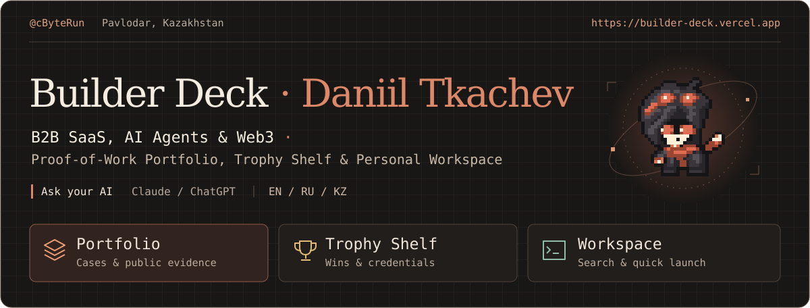
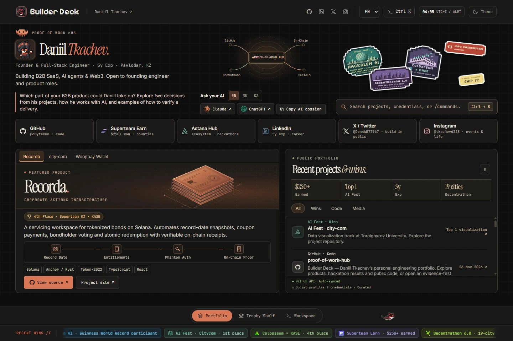
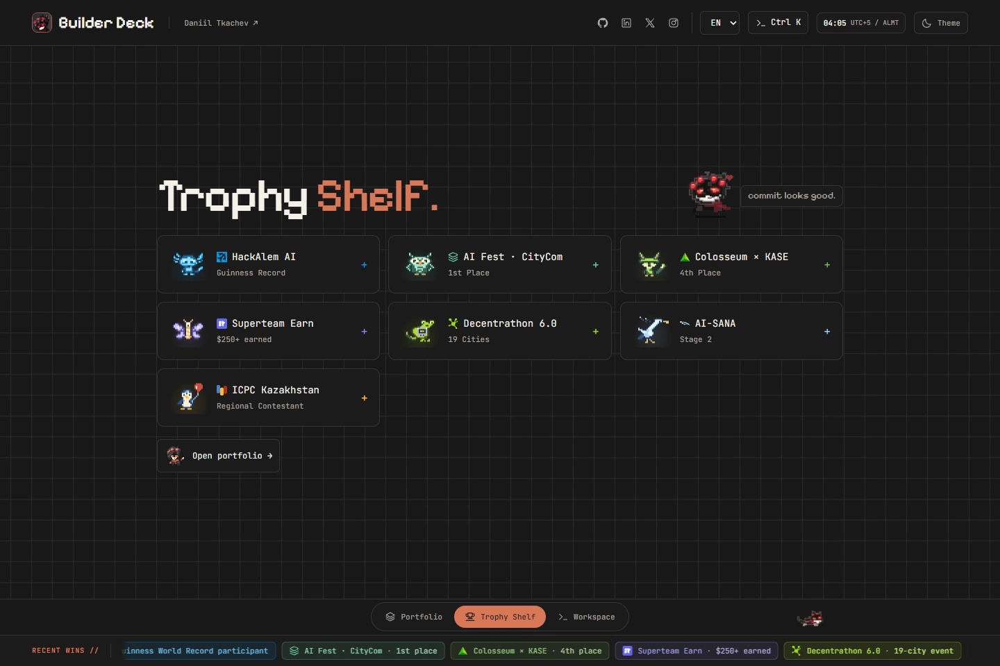
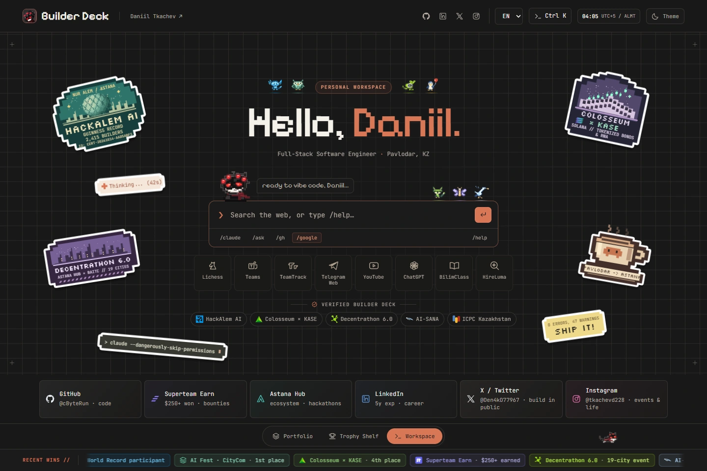

# Builder Deck



Я Даниил Ткачёв, фаундер и full-stack инженер из Павлодара, Казахстан. Разрабатываю B2B SaaS, инструменты с AI-агентами и приложения на Solana. В Builder Deck я собрал кейсы вместе с кодом, демо и подтверждениями достижений. Рядом с публичным портфолио — мой рабочий стол для новой вкладки браузера.

[Live Demo](https://builder-deck.vercel.app/) · [GitHub](https://github.com/cByteRun) · [LinkedIn](https://www.linkedin.com/in/daniil-tkachev-2b2970363/) · [X @Den4kD77967](https://x.com/Den4kD77967) · [Instagram @tkachevd228](https://www.instagram.com/tkachevd228/)

**Навигация**

[Тур за пять минут](#tour) · [С чего начать](#roles) · [Экраны](#screens) · [Проекты](#projects) · [Ask your AI](#ai) · [Запуск и деплой](#development) · [Структура](#structure) · [Данные и ограничения](#data)

<a id="tour"></a>

## Как посмотреть за пять минут

1. **Откройте Portfolio.** Выберите EN, RU или KZ. Переключите вкладки Recorda, city-com и Wooppay Wallet. У каждой меняются иллюстрация, описание задачи, схема из четырёх этапов, стек и ссылки. В ленте *Recent projects & wins* попробуйте фильтры Wins, Code и Media. [Открыть портфолио](https://builder-deck.vercel.app/)
2. **Проверьте один вывод через Ask your AI.** Выберите Claude или ChatGPT, допишите свою роль и вопрос в черновик. Например, попросите показать, где Recorda фиксирует получателей купона. После отправки откройте источник из ответа. Кнопка *Copy AI dossier* позволяет забрать исходный текст на выбранном языке.
3. **Найдите подтверждение достижения.** Раскройте HackAlem AI или AI-SANA на полке наград. Чтобы скопировать номер одной кнопкой, откройте Ctrl+K / ⌘K, введите название, выберите результат категории *Credential* и нажмите на идентификатор. [Открыть Trophy Shelf](https://builder-deck.vercel.app/#shelf)
4. **Попробуйте Workspace.** Введите `/help`, затем `/gh recorda` или `/claude`. Перетащите наклейку и дважды щёлкните по ней, чтобы повернуть. С клавиатуры выберите наклейку клавишей Tab, двигайте стрелками и поворачивайте клавишей R. [Открыть Workspace](https://builder-deck.vercel.app/#workspace)

<a id="roles"></a>

## С чего начать именно вам

| Ваша роль | Что открыть | Какой вопрос проверить |
| --- | --- | --- |
| B2B-заказчик | [Сценарий CityCom](https://github.com/cByteRun/city-com#сценарий-демонстрации) | Как обращение жителя попадает к ответственному отделу? Можно ли проследить решение до исходного сообщения? |
| Tech Lead / Team Lead | [Руководство Recorda по операциям](https://github.com/cByteRun/recorda-solana/blob/main/docs/BONDOPS-OPERATIONS.md) | Как определяется получатель купона после передачи облигации? Чем следующий разработчик подтвердит результат операции? |
| Потенциальный кофаундер | [Исходное ТЗ IdeaRoute](https://github.com/cByteRun/kinetria-ai/blob/main/docs/TENDER_BRIEF.md) и [профиль Superteam Earn](https://superteam.fun/earn/t/protective-fuchsia-78) | Какие задачи уже доведены до проверяемого результата? Что ещё нужно выяснить о личном вкладе, пользователях и спросе? |

<a id="screens"></a>

## Экраны и общие инструменты

### Portfolio

На главной странице открыт кейс Recorda. В соседних вкладках можно изучить city-com и Wooppay Wallet, справа — найти проекты и победы, а через *Ask your AI* — подготовить вопросы о работе Даниила для Claude или ChatGPT. [Открыть Portfolio ↗](https://builder-deck.vercel.app/)



### Trophy Shelf

У каждого из семи достижений свой пиксельный питомец. Нажмите, например, на Decentrathon 6.0, чтобы прочитать о результате, или на HackAlem AI, чтобы увидеть номер сертификата. [Открыть Trophy Shelf ↗](https://builder-deck.vercel.app/#shelf)



### Workspace

Моя стартовая страница для новой вкладки. В центре — командная строка и восемь быстрых ссылок. Введите `/help`, чтобы посмотреть команды, или `/gh recorda`, чтобы найти проект на GitHub. Наклейки по краям можно передвигать и поворачивать. [Открыть Workspace ↗](https://builder-deck.vercel.app/#workspace)



### Общие инструменты

| Инструмент | Что доступно |
| --- | --- |
| Ctrl+K / ⌘K | Найти проект, профиль или сертификат, скопировать AI-досье или перейти на другой экран. |
| EN / RU / KZ | Сменить язык портфолио. Язык черновика AI-досье можно выбрать отдельно. |
| Theme | Выбрать тему рабочего стола — Claude Code, Vibe Coding V1 или Vibe Coding V2. |
| Recent Wins | Навести указатель на нижнюю ленту, чтобы остановить прокрутку и прочитать результат. |

<a id="projects"></a>

## Проекты на витрине

| Проект | Задача | Стек | Что можно проверить |
| --- | --- | --- | --- |
| [Recorda](https://github.com/cByteRun/recorda-solana) | Обслуживание токенизированных облигаций: реестр держателей на дату фиксации, купоны, голосование и погашение. | Solana, Anchor / Rust, Token-2022, TypeScript, React | Демонстрация в Solana devnet; 4-е место в треке Superteam KZ × KASE. [Стенд](https://recorda-solana.vercel.app/) · [Операции](https://github.com/cByteRun/recorda-solana/blob/main/docs/BONDOPS-OPERATIONS.md) |
| [city-com](https://github.com/cByteRun/city-com) | Разбор городских обращений на русском и казахском с привязкой к источнику, приоритету и ответственному отделу. | Next.js, TypeScript, Recharts, SQLite | 1-е место в направлении визуализации данных на AI & Digital Bridge в Торайгыров университете. Проект можно пройти по опубликованному сценарию. [Сценарий демонстрации](https://github.com/cByteRun/city-com#сценарий-демонстрации) |
| [Wooppay Wallet](https://github.com/cByteRun/wooppay-wallet-web) | Веб-концепт кошелька с локализованными страницами, структурированными данными и правилами индексации. | Next.js App Router, TypeScript, SEO | На стенде доступны публичные страницы концепта. В репозитории описан локальный запуск. [Стенд](https://wooppay-wallet-web.vercel.app/) |

<a id="ai"></a>

## Что проверяет Ask your AI

Builder Deck готовит редактируемый бриф для внешнего AI-ассистента. В нём заданы источники и вопросы: как исходное ТЗ IdeaRoute связано с реализацией, какие решения приняты в Recorda и CityCom, что подтверждают репозитории, демо и результаты хакатонов. Бриф просит различать работу продукта, свидетельства личного вклада и роль AI, приводить ссылки и отмечать пробелы в данных.

Выберите сервис и язык, уточните интересующий сценарий, проверьте текст и отправьте его в открывшемся чате. Если сервис не подставил длинный черновик, используйте *Copy prompt* и *Open a blank chat*. Качество выводов зависит от доступа выбранного ассистента к источникам. [Три версии брифа и формирование ссылок](./src/portfolio/dossier.js)

<a id="development"></a>

## Запуск, сборка и деплой

Для сборки нужны Node.js 20+ и npm. Для локального HTTP-сервера команда `npm run dev` также использует Python 3, доступный как `python3`.

```sh
npm ci
npm run dev
```

Откройте [локальный Portfolio](http://127.0.0.1:8080/) или [локальный Workspace](http://127.0.0.1:8080/#workspace). Перед запуском сервера npm автоматически выполняет сборку. После правки исходников повторите `npm run build` и обновите страницу.

В Windows с Python Launcher можно выполнить `npm run build`, затем `py -3 -m http.server 8080 --bind 127.0.0.1 --directory dist`.

```sh
npm run lint
npm run typecheck
npm run build
```

Сборка записывает статический сайт в `dist/`, собирает SVG питомцев и генерирует обложку README из шаблона и локального маскота. Коммитьте шаблон вместе с обновлённым `docs/readme-cover.svg`, чтобы GitHub сразу показал новую иллюстрацию.

Vercel выполняет `node scripts/build.mjs` и публикует каталог `dist/`. В подключённом проекте изменения в ветке получают Preview, слияние в `main` обновляет production. [Конфигурация Vercel](./vercel.json) · [Production](https://builder-deck.vercel.app/)

<a id="structure"></a>

## Структура проекта

| Путь | Содержимое |
| --- | --- |
| [index.html](./index.html), [src/main.js](./src/main.js) | Оболочка, шапка, нижняя навигация, маршруты по фрагменту URL и переключение тем. |
| [src/portfolio/catalog.js](./src/portfolio/catalog.js), [controller.js](./src/portfolio/controller.js) | Каталог кейсов, профилей и источников; выбор кейса, фильтрация ленты, запросы к GitHub и командная палитра. |
| [src/portfolio/dossier.js](./src/portfolio/dossier.js), [messages.js](./src/portfolio/messages.js) | AI-брифы на трёх языках и словарь интерфейса. |
| [src/data/profile.js](./src/data/profile.js), [src/components/mascots/](./src/components/mascots/) | Результаты и идентификаторы наград, палитры, рисунки и реакции питомцев. |
| [src/data/search.js](./src/data/search.js), [shortcuts.js](./src/components/shortcuts.js), [stickers.js](./src/components/stickers.js) | Провайдеры поиска, адреса восьми быстрых ссылок и управление наклейками Workspace. |
| [src/themes/](./src/themes/), [src/styles/](./src/styles/) | Токены трёх тем, общие стили, типографика и анимации. |
| [assets/](./assets/) | Локальные шрифты, маскот, иллюстрации кейсов, наклейки и CSS для Firefox. |
| [scripts/build.mjs](./scripts/build.mjs), [шаблон обложки](./scripts/readme-cover.template.svg), [docs/readme-cover.svg](./docs/readme-cover.svg) | Сборка сайта, редактируемая композиция обложки и готовая иллюстрация для GitHub. |

<a id="data"></a>

## Источники данных и ограничения

- **GitHub API.** Браузер получает публичные репозитории `cByteRun`. Срок действия локального кеша — 10 минут, тайм-аут запроса — 6,5 секунды. При недоступности API или ограничении частоты запросов лента показывает сохранённые данные либо подборку из каталога. Результаты хакатонов и ссылки на соцпрофили заданы вручную.
- **Сертификаты.** У HackAlem AI и AI-SANA опубликованы идентификаторы. Запись в каталоге может вести на профиль участника, страницу организатора или репозиторий проекта. Для проверки конкретного результата используйте источник, указанный в карточке, и номер документа, если он есть.
- **Настройки браузера.** Язык, тема, позиции наклеек и кеш ленты хранятся в `localStorage` для текущего домена. Очистка данных сайта сбрасывает сохранённые настройки. У production, Preview и localhost раздельные хранилища.
- **Границы приложения.** Все три экрана публичны. Статические HTML, CSS, JavaScript, шрифты и SVG обслуживаются с одного сайта. Для свежих данных GitHub, внешних стендов и чатов нужен интернет. Работа приложения и генерация обложки используют файлы этого репозитория.
